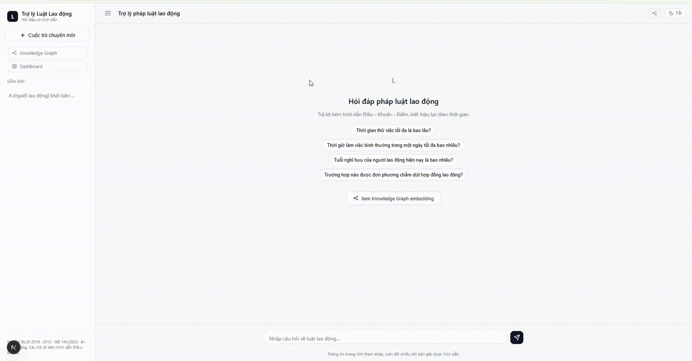
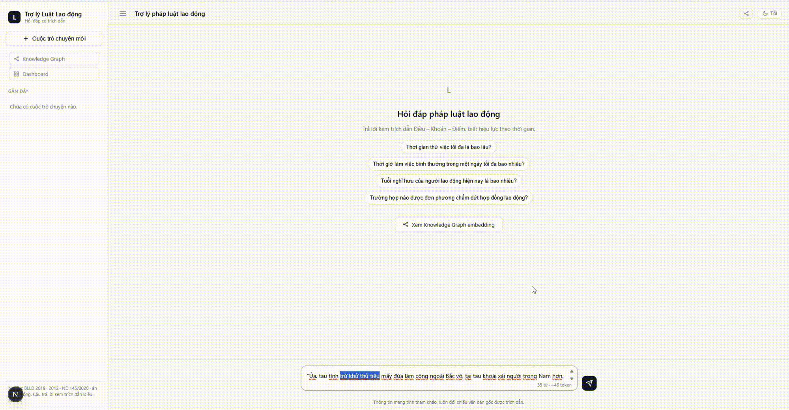

# Trợ lý Pháp luật Lao động Việt Nam 🇻🇳

> AI Assistant for Vietnamese Labor Law — built from scratch with FastAPI, pgvector, and custom Vietnamese embeddings.

[](https://fastapi.tiangolo.com/)
[](https://nextjs.org/)
[](https://www.postgresql.org/)
[](https://github.com/pgvector/pgvector)
[](https://www.docker.com/)
[](LICENSE)

**📖 API Docs:** `http://localhost:8000/docs` sau khi chạy cục bộ · **[📋 Tổng quan kỹ thuật](docs/TONG-QUAN-DU-AN.md)**

<p align="center">
  
</p>

---

## Tổng quan dự án

Trợ lý AI hỏi đáp **pháp luật lao động Việt Nam**, với RAG có trích dẫn làm lõi và một vài tính năng pháp chế thực tế xoay quanh nó:

| Tính năng                       | Mô tả                                                                                                                          |
| ------------------------------- | ------------------------------------------------------------------------------------------------------------------------------ |
| **Trả lời có trích dẫn**        | Mỗi câu trả lời kèm Điều–Khoản–Điểm cụ thể; từ chối khi không đủ căn cứ, không bịa trích dẫn                                   |
| **Đề xuất câu hỏi chuẩn hơn**   | Câu hỏi dùng từ đời thường ("bị đuổi việc") được đề xuất lại bằng đúng thuật ngữ luật, một nút bấm để dùng                     |
| **Chặn câu lạc đề / chèn lệnh** | Mẫu cố định + phân loại bằng LLM: câu ngoài phạm vi lao động, hoặc cố điều khiển trợ lý, đều bị chặn trước khi tới LLM trả lời |
| **Phê duyệt có người thật**     | Câu hỏi đúng phạm vi nhưng ngoài kho văn bản được chuyển cho chuyên gia duyệt và trả lời trực tiếp (human-in-the-loop)         |
| **Knowledge Graph 2 chiều**     | Đồ thị quan hệ Văn bản → Chương → Điều → Khoản → Điểm, kèm bản đồ ontology để lọc theo triplet                                 |
| **Hiệu lực theo thời gian**     | Hỏi "luật năm 2015" → ra BLLĐ 2012; hỏi "hiện tại" → ra BLLĐ 2019 + NĐ145                                                      |
| **Tác vụ pháp chế thực tế**     | Soạn văn bản NĐ30, tổng hợp 150 bản án/án lệ lao động                                                                          |


---

## Các tính năng

### Đề xuất câu hỏi pháp lý chuẩn hơn
Người dùng hỏi bằng từ ngữ đời thường — trợ lý nhận ra câu hỏi mơ hồ so với thuật ngữ luật, đề xuất lại đúng cách hỏi, một nút bấm để dùng ngay.

<p align="center">
  
</p>

### Phê duyệt có người thật (human-in-the-loop)
Câu hỏi đúng phạm vi lao động nhưng cần văn bản chưa có trong kho (ví dụ hỏi về luật của một năm chưa ra) được ghi nhận và chờ chuyên gia duyệt trên trang Dashboard — chuyên gia viết câu trả lời hoặc từ chối kèm lý do, thẻ trong khung chat tự cập nhật kết quả.

<p align="center">
  
</p>

### Knowledge Graph & bản đồ ontology
Đồ thị quan hệ xoay quanh kết quả tra cứu (Văn bản — Chương — Điều — Khoản — Điểm), nhóm theo Chương hoặc theo Văn bản, cùng bản đồ ontology bên phải để lọc theo triplet (chủ ngữ – vị ngữ – tân ngữ) và làm nổi phần liên quan.

<p align="center">
  
</p>

---

## Kiến trúc kỹ thuật

```
Browser (Next.js 15)  ──SSE stream──▶  FastAPI  ──▶  PostgreSQL 17 + pgvector
                                          │
                          guard.py ◀──────┤   mẫu cố định (chèn lệnh) + phân loại
                      (lọc trước LLM)     │   bằng LLM (lạc đề / ngoài kho / mơ hồ)
                                          ▼
                         LLMRouter: đua song song 3 model Dahl
                         (DeepSeek-V4 / GLM-5.3 / MiniMax-M2),
                         Gemini vào cuộc đua nếu Dahl chậm > 15s
                                          │
                                          ▼
                         Vietnamese_Embedding_v2 (self-hosted)
                         AITeamVN/Vietnamese_Embedding_v2, 1024-dim
```

| Tầng | Công nghệ | Ghi chú |
|---|---|---|
| **Web** | Next.js 15 (App Router), React 19, TypeScript | SSE streaming, citation chips |
| **API** | FastAPI, Uvicorn, Pydantic v2, SQLAlchemy 2 | Async SSE via `POST /api/chat` |
| **Database** | PostgreSQL 17 + pgvector + pg_trgm | Vector (1024d) + trigram hybrid search |
| **Embedding** | AITeamVN/Vietnamese_Embedding_v2 (self-hosted) | Không gửi dữ liệu ra ngoài |
| **LLM** | `LLMRouter`: đua 3 model Dahl song song, Gemini/Claude dự phòng | Mỗi câu hỏi gửi đồng thời tới nhiều model, lấy câu trả lời hợp lệ sớm nhất |
| **Guard** | `app/agent/guard.py` | Chặn chèn lệnh bằng mẫu + phân loại 5 nhóm câu hỏi bằng LLM |
| **Deploy** | Docker Compose | `postgres` + `api` + `web` + `langfuse` (optional) |

### Điểm kỹ thuật đáng chú ý

- **Hybrid RAG**: pgvector cosine + trigram/ILIKE + lọc `effective_from/to` — truy xuất chính xác không cần Elasticsearch
- **Citation grounding**: LLM chỉ được trích dẫn node đã nằm trong kết quả retrieval; hallucinate citation hoặc trả lời rỗng → không được thắng cuộc đua model
- **Đua LLM song song (LLM racing)**: một câu hỏi gửi đồng thời tới 3 model nhỏ; model nào trả JSON hợp lệ, đúng tiếng Việt, có căn cứ sớm nhất thì thắng — vừa nhanh vừa né lỗi "hết chỗ" của API miễn phí
- **Tình huống pháp lý dài**: câu hỏi trên 60 từ (kiểu án lệ, nhiều vấn đề cùng lúc) được tự tách thành 2–4 vấn đề pháp lý, tra riêng từng vấn đề rồi gộp kết quả
- **Guard 2 lớp**: mẫu cố định chặn chèn lệnh không cần gọi LLM; lớp phân loại bằng LLM xử lý câu lạc đề, câu ngoài kho, câu dùng từ đời thường — chạy song song với bước trả lời nên không chậm câu hỏi hợp lệ
- **Time-travel law**: `law_as_of(date)` dùng CTE trên `node_supersession` để theo chuỗi BLLĐ 2012 → BLLĐ 2019
- **No external embedding API**: model tự host trong Docker container → 0 đồng gọi API, latency ổn định

### Đo trên bộ 18 câu hỏi mẫu nội bộ

| | Đúng Điều trích dẫn | Trung bình | Lâu nhất |
|---|---|---|---|
| Đua 3 model Dahl + Gemini dự phòng | 18/18 | ~15s | ~23s |
| 146 test backend (pytest) | đều pass | — | — |

---

## Dữ liệu pháp lý

| Văn bản | Mã định danh | Quy mô |
|---|---|---|
| BLLĐ 2019 (45/2019/QH14) | `blld2019` | 220 Điều, ~1.132 node |
| BLLĐ 2012 (10/2012/QH13) | `blld2012` | 242 Điều, ~1.071 node (hết hiệu lực 01/01/2021) |
| NĐ 145/2020/NĐ-CP | `nd145_2020` | 115 Điều, ~880 node |
| Án lệ/bản án lao động | bảng `precedent` | 150 bản án (Hugging Face) |


---

## Chạy cục bộ (5 phút)

**Yêu cầu:** Docker Desktop đang chạy.

```bash
# 1. Clone
git clone https://github.com/MinhBe/RAG.git && cd RAG

# 2. Cấu hình — điền ít nhất 1 khóa LLM miễn phí (Gemini hoặc Dahl)
cp .env.example .env
# Mở .env, điền GEMINI_API_KEY_1=... (hoặc Dahl_token_1=... nếu có)

# 3. Khởi động
docker compose up -d --build

# Lần đầu tải model embedding (~1.5 GB), mất khoảng 5 phút.
# Kiểm tra: docker compose logs api -f
```

- **Giao diện**: http://localhost:3000
- **API + Swagger**: http://localhost:8000/docs
- **Quan sát (optional)**: `docker compose --profile obs up -d` → http://localhost:3002

Dừng: `docker compose down` (thêm `-v` nếu muốn xóa cả dữ liệu DB).

### Chạy bản đóng gói v1.0 (final)

Image `<dockerhub-user>/lawvn-api:1.0` đã có sẵn khóa Dahl, chỉ cần chạy:

```bash
docker run -p 7860:7860 <dockerhub-user>/lawvn-api:1.0
# Thêm Gemini làm dự phòng (tùy chọn):
docker run -p 7860:7860 -e GEMINI_API_KEY_1=... <dockerhub-user>/lawvn-api:1.0
```

---

## Demo nhanh qua API

```bash
# Hỏi đáp có trích dẫn
curl -N -X POST http://localhost:8000/api/chat \
  -H 'Content-Type: application/json' \
  -d '{"message": "Người lao động có thể đơn phương chấm dứt hợp đồng không?", "thread_id": "demo"}'

# Tra hiệu lực theo thời gian
curl "http://localhost:8000/api/law_as_of?date=2015-06-01&doc_id=blld2019"

# Soạn quyết định xử lý kỷ luật
curl -X POST http://localhost:8000/api/draft/preview \
  -H 'Content-Type: application/json' \
  -d '{"doc_type": "quyet_dinh_ky_luat", "params": {"ho_ten": "Nguyễn Văn A", "hinh_thuc": "Cảnh cáo"}}'
```

---

## Cấu trúc repo

```
RAG/
├── backend/
│   ├── app/
│   │   ├── agent/        # pipeline.py, qa.py (RAG + citations), guard.py (chặn chèn lệnh + phân loại), precedent.py
│   │   ├── amend/        # diff.py (so sánh 2 phiên bản), store.py (node_supersession)
│   │   ├── api/          # routes.py — toàn bộ endpoint
│   │   ├── db/           # models.py (PostgreSQL schema), base.py
│   │   ├── draft/        # nd30.py — soạn văn bản NĐ30 + xuất DOCX
│   │   ├── graph/        # builder.py — dựng Knowledge Graph quanh kết quả tra cứu
│   │   ├── ingestion/    # parser.py (Điều–Khoản–Điểm), ingest.py (Hugging Face → DB)
│   │   ├── llm/          # router.py — LLMRouter (đua model Dahl, Gemini/Claude/FPT, retry, JSON coerce)
│   │   ├── rag/          # embeddings.py, search.py (hybrid), text.py (Vietnamese tokenizer)
│   │   └── report/       # multi_doc.py — báo cáo nhiều văn bản
│   └── scripts/          # ingest, reembed, smoke tests
├── frontend/             # Next.js 15, SSE client, citation chips, Knowledge Graph (d3)
├── db/init/              # PostgreSQL init SQL (pgvector, pg_trgm)
├── docker-compose.yml
└── docs/
    └── TONG-QUAN-DU-AN.md  # Tài liệu kiến trúc chi tiết
```

---

## Acknowledgements

- Dữ liệu: HF `th1nhng0/vietnamese-legal-documents` · `tmquan/anle-toaan-gov-vn` (CC-BY 4.0)


