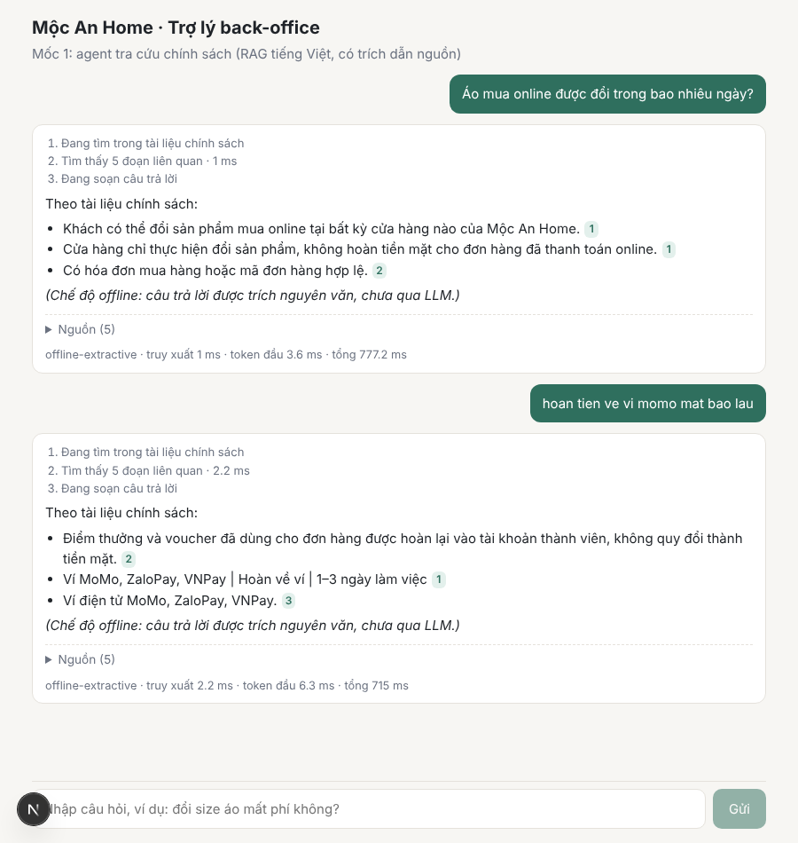

# Trợ lý back-office bằng AI Agent cho doanh nghiệp nhỏ Việt Nam

Hệ thống nhận yêu cầu của khách hàng và nhân viên (hỏi chính sách đổi trả, tra đơn hàng, gửi hóa đơn scan, xin báo cáo doanh thu), chia cho các agent chuyên trách xử lý, dừng lại chờ người duyệt ở những việc rủi ro, và đo chất lượng, chi phí, độ trễ cho từng request.

Dữ liệu là của một cửa hàng giả lập, **Mộc An Home**: tài liệu chính sách tự soạn bằng tiếng Việt và một DB đơn hàng sinh tự động.

> **Trạng thái: mốc 1/8 (MVP).** Đã có agent tra cứu chính sách bằng RAG tiếng Việt, trả lời có trích dẫn nguồn, UI chat streaming. Các agent còn lại nằm trong [lộ trình](#lộ-trình).



## Số đo hiện tại

Chỉ ghi số đã đo thật. Bộ câu hỏi còn nhỏ (24 câu, [`eval/retrieval_smoke.jsonl`](eval/retrieval_smoke.jsonl)) và do người viết tài liệu tự soạn, nên dùng để so sánh các phương án với nhau, chưa phải chất lượng tuyệt đối.

| Truy xuất (embedder hashing) | R@1 | R@3 | R@5 | MRR |
|---|---|---|---|---|
| BM25 | 0,83 | 0,88 | 0,96 | 0,87 |
| Vector | 0,50 | 0,83 | 0,88 | 0,66 |
| **Hybrid (RRF)** | 0,79 | **0,96** | 0,96 | 0,85 |

Thời gian truy xuất khoảng 1–2 ms trên 23 chunk. Chưa có số đo cho câu trả lời của LLM (faithfulness, hallucination): việc này thuộc mốc 6, cùng bộ 150–200 câu hỏi có đáp án chuẩn.

## Chạy thử

### Docker Compose

```bash
cp .env.example .env          # điền ANTHROPIC_API_KEY nếu có, để trống thì chạy chế độ offline
docker compose up --build
```

- UI: http://localhost:3000
- API: http://localhost:8000/docs
- Postgres (DB đơn hàng giả lập, dùng từ mốc 2): `localhost:5432`, user/pass `backoffice`

**Chế độ offline**: khi không có API key, câu trả lời được ghép từ các dòng trích nguyên văn trong tài liệu. Truy xuất, trích dẫn, streaming và số đo vẫn chạy đầy đủ, chỉ phần diễn đạt là chưa qua LLM.

### Chạy riêng từng phần (dev)

```bash
# backend
cd backend
python -m venv .venv && source .venv/bin/activate
pip install -r requirements-dev.txt
uvicorn app.main:app --reload            # http://localhost:8000
pytest -q                                # 17 test, không gọi API trả phí
python scripts/eval_retrieval.py         # in bảng recall@k ở trên

# frontend
cd frontend
npm install
npm run dev                              # http://localhost:3000
npm test                                 # test parser SSE
```

Thử nhanh API:

```bash
curl -N -X POST localhost:8000/api/chat -H 'content-type: application/json' \
  -d '{"message": "hoan tien ve vi momo mat bao lau"}'
```

## Kiến trúc

Hiện tại (mốc 1):

```
Next.js (chat, SSE) ──POST /api/chat──► FastAPI (async)
                                            │
                                     KnowledgeAgent
                          ┌─────────────────┼─────────────────┐
                    HybridIndex          Claude API        sự kiện SSE
              BM25 + vector + RRF    (hoặc offline)   step · sources · token · done
                          │
              data/policies/*.md (chunk theo mục, giữ nguyên bảng)
```

Mục tiêu (mốc 8):

```
Next.js UI (chat streaming SSE + hộp duyệt) ──► FastAPI (async)
                                                   │
                                     LangGraph Supervisor
        ┌──────────────┬──────────────┼──────────────┬──────────────┐
   Intake/Router   Knowledge      Order Ops      Document       Reporter
   (phân loại)     (RAG)          (tool/MCP)     (OCR+trích)    (tổng hợp)
                                       │
                         MCP servers: orders-db (Postgres), mail/chat mock, file store
   ───────────────────────────────────────────────────────────────────────
   pgvector · Langfuse (trace) · Promptfoo/DeepEval (eval CI) · Docker
```

Một request đi qua mốc 1:

1. **Truy xuất**: câu hỏi được tách thành âm tiết, cặp âm tiết và bản bỏ dấu, chấm điểm BM25; song song tính vector; hai bảng xếp hạng gộp bằng Reciprocal Rank Fusion. Không có chunk nào khớp từ khóa và vector quá xa thì trả lời "chưa tìm thấy" mà không gọi LLM.
2. **Sinh câu trả lời**: top 5 chunk đưa vào prompt dưới dạng `<tai_lieu id="n">`, model phải ghi `[n]` sau mỗi ý. System prompt coi nội dung tài liệu là dữ liệu, không phải chỉ dẫn.
3. **Kiểm tra**: server tách các số `[n]`, báo trích dẫn không tồn tại (`invalid_citations`), trả độ trễ từng chặng, token và chi phí trong sự kiện `done`.

Lý do của từng lựa chọn nằm trong [docs/decisions](docs/decisions/README.md).

## Cấu trúc thư mục

```
backend/
  app/
    main.py              FastAPI: /api/chat (SSE), /api/health, /api/documents
    agents/knowledge.py  agent RAG: prompt, trích dẫn, sự kiện stream
    rag/                 tách từ tiếng Việt, chunking, BM25, embedder, hybrid index
    llm.py               Claude (Anthropic SDK) và LLM offline
  scripts/
    eval_retrieval.py    recall@k, MRR cho BM25 / vector / hybrid
    seed_orders.py       sinh DB đơn hàng giả lập (200 khách, 1.500 đơn)
  tests/
frontend/                Next.js 15, React 19
data/policies/           5 tài liệu chính sách tự soạn
db/init/                 schema + seed Postgres
eval/                    bộ câu hỏi đánh giá
docs/decisions/          ADR
```

## Lộ trình

| Tuần | Mốc | Trạng thái |
|---|---|---|
| 1–2 | MVP: FastAPI + agent RAG trả lời chính sách có trích dẫn, UI chat streaming | ✅ Xong |
| 3–4 | Multi-agent LangGraph + MCP server cho DB đơn hàng + human-in-the-loop | |
| 5 | Agent đọc chứng từ: OCR hóa đơn → JSON đã validate | |
| 6 | Eval 150–200 câu + Langfuse + CI gate | |
| 7 | Guardrails, fallback model, cache, định tuyến model | |
| 8 | Hoàn thiện README, video demo, bài viết kỹ thuật | |

## Ghi công

Toàn bộ code trong repo được viết mới. Các dự án đã tham khảo ý tưởng (không chép code): `wassim249/fastapi-langgraph-agent-production-ready-template`, `langchain-ai/agents-from-scratch`, `bangoc123/retrieval-backend-with-rag`. Nếu sau này dùng lại đoạn code nào từ dự án có giấy phép MIT, thông báo bản quyền gốc sẽ được giữ và ghi ở đây.

Có dùng Claude (Anthropic) làm LLM trả lời, và Claude Code hỗ trợ viết code.

Tài liệu chính sách, tên khách hàng, số điện thoại trong dữ liệu mẫu đều là giả lập, không thuộc doanh nghiệp hay cá nhân có thật.
